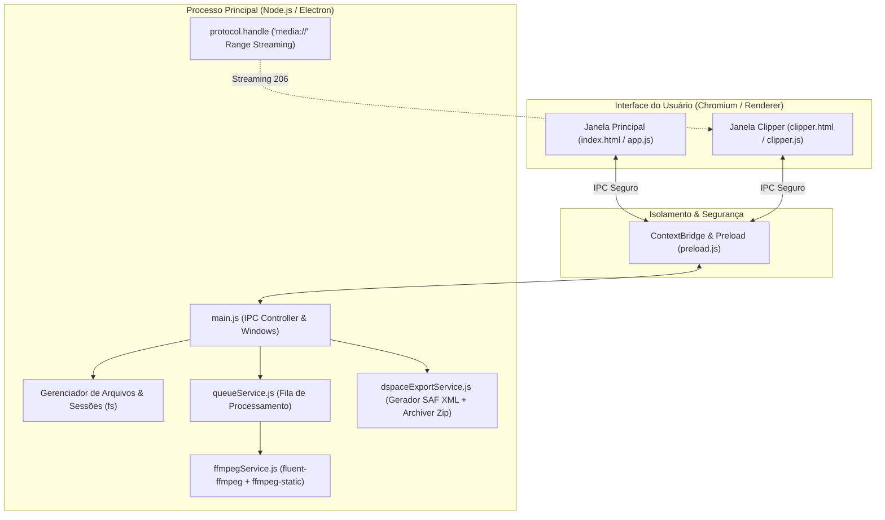

# 🏛️ Catalogador ALIM & Decupador Audiovisual

> **Aplicativo Desktop 100% Offline para Catalogação Linguística, Decupagem Audiovisual em Fila e Exportação DSpace SAF.**  
> Desenvolvido para o **Projeto ALIM** (Acervo de Línguas Indígenas e Memórias / Acervo Linguístico e de Imagem das Memórias).

[](LICENSE)
[](https://www.electronjs.org/)
[](https://nodejs.org/)
[](https://ffmpeg.org/)
[](https://wiki.lyrasis.org/display/DSDOC/Simple+Archive+Format)

---

## 📌 Sumário

1. [Sobre o Aplicativo](#-sobre-o-aplicativo)
2. [Para Que Serve](#-para-que-serve)
3. [Principais Funcionalidades](#-principais-funcionalidades)
4. [Arquitetura Técnica](#-arquitetura-t%C3%A9cnica)
5. [Como Instalar e Usar](#-como-instalar-e-usar)
6. [Roteiro do Desafio DIO](#-roteiro-do-desafio-dio)
   - [1. A Dor Escolhida e Por Que Vale um Negócio](#1-a-dor-escolhida-e-por-que-vale-um-neg%C3%B3cio)
   - [2. Tamanho de Mercado e Business Model Canvas (BMC)](#2-tamanho-de-mercado-e-business-model-canvas-bmc)
   - [3. Tese do MVP e o Que Ficou Manual de Propósito](#3-tese-do-mvp-e-o-que-ficou-manual-de-prop%C3%B3sito)
   - [4. O Mega Prompt e as Correções Solicitadas](#4-o-mega-prompt-e-as-corre%C3%A7%C3%B5es-solicitadas)
   - [5. Endereço da Aplicação Publicada](#5-endere%C3%A7o-da-aplica%C3%A7%C3%A3o-publicada)
7. [Licença e Autoria](#-licen%C3%A7a-e-autoria)

---

## 📖 Sobre o Aplicativo

O **Catalogador ALIM & Decupador Audiovisual** é um software desktop nativo e **100% offline**, projetado para pesquisadores, linguistas, antropólogos, documentalistas e curadores de acervos de memória cultural e línguas ameaçadas, que usam Dublin Core. Surgiu a partir da necessidade da criação de metadados para Acervo de Línguas Indígenas do Museu Paraense Emílio Goeldi (ALIM).

Construído com base no framework [Electron](https://www.electronjs.org/), integrando Node.js e o motor de mídia [FFmpeg](https://ffmpeg.org/), o aplicativo soluciona de ponta a ponta o ciclo de vida do trabalho de campo:
1. **Catalogação Descritiva Estruturada:** Formulários inspirados no software de documentação de línguas *Lameta*, padronizados no esquema internacional **Dublin Core** (`dc.*`).
2. **Organização Físico-Digital Rígida:** Gerenciamento isolado de sessões em pastas de trabalho locais (*workspaces*), com cópia física de mídias e referências por caminhos relativos portáveis.
3. **Decupagem de Mídia Sem Perda:** Janela dedicada de decupagem (*Clipper*) com reprodução fluida via protocolo customizado de streaming e enfileiramento de recortes em segundo plano sem re-encoding (`-c copy`), preservando a fidelidade acústica e a integridade de vídeo.
4. **Preservação e Interoperabilidade:** Exportação automatizada em lote no padrão **DSpace Simple Archive Format (SAF)** com geração de `dublin_core.xml`, arquivo `contents` e mídias empacotadas em arquivos compactados `.zip`, prontos para ingestão direta em repositórios digitais institucionais.

---

## 🎯 Para Que Serve

O aplicativo atende a necessidades fundamentais de preservação digital e soberania da memória:

- **Documentação de Línguas Indígenas e Tradicionais:** Permite a pesquisadores registrar narrativas orais, cantos, rituais e diálogos em comunidades remotas sem nenhuma dependência de acesso à internet.
- **Trabalho de Campo Confiável:** Garante que mídias pesadas (áudios WAV de alta resolução, vídeos em 4K/Full HD) sejam arquivadas em uma estrutura determinística, impedindo que links se quebrem ao mover a pasta de trabalho entre computadores.
- **Extração Rápida de Fragmentos Significativos:** Possibilita isolar trechos específicos de longas gravações de horas sem necessitar de editores de vídeo pesados (como Adobe Premiere ou DaVinci Resolve) e sem gastar horas re-renderizando arquivos.
- **Ponte Direta para Repositórios Acadêmicos:** Elimina a tarefa manual, cansativa e propensa a erros de criar XMLs de metadados e arquivos de manifesto para sistemas como o DSpace de universidades públicas e centros de documentação.

---

## ✨ Principais Funcionalidades

- **Operação 100% Offline:** Sem telemetria, sem autenticação em nuvem e sem risco de vazamento de dados sensíveis ou gravações com restrições culturais.
- **Estrutura de Sessões Padronizada:** Cada sessão possui seu próprio arquivo JSON de metadados (`sessao_XX.json`) e sua pasta exclusiva de mídias (`sessao_XX_midias/`).
- **Formulário Dublin Core Extensível:**
  - Título (`dc.title`), Tipo (`dc.type`), Orientador/Pesquisador (`dc.contributor.advisor`), Datas (`dc.date.created`, `dc.date.issued`), Identificador (`dc.identifier.other`);
  - Resumo e Descrição (`dc.description.abstract`, `dc.description.sponsorship`, `dc.publisher`);
  - Idiomas com código ISO (`dc.language`, `dc.language.iso`) e Cobertura Geográfica (`dc.coverage.spatial`);
  - Campos dinâmicos multivalorados com adição e remoção sob demanda.
- **Clonagem Ágil de Sessões:** Duplica metadados da sessão ativa (como equipe, localização e contexto de pesquisa) para criar uma nova sessão em segundos, economizando digitação repetitiva.
- **Streaming Local e Seek Preciso:** Protocolo proprietário `media://` com suporte a cabeçalhos HTTP `Range` (status 206 Partial Content), permitindo navegar em vídeos de gigabytes instantaneamente sem travar a memória RAM.
- **Decupador Dedicado com Atalhos:**
  - <kbd>Espaço</kbd>: Play / Pause
  - <kbd>I</kbd>: Marcar ponto inicial (IN)
  - <kbd>O</kbd>: Marcar ponto final (OUT)
  - Enfileiramento contínuo: adicione vários recortes sem fechar o player.
- **Fila FFmpeg em Background:**
  - Processamento não destrutivo com `-c copy` (corte instantâneo por cópia direta de stream);
  - Acompanhamento em tempo real da barra de progresso e porcentagem de cada item;
  - Controles de **Pausar Fila**, **Retomar Fila** e **Cancelar Corte**.
- **Exportação SAF (Simple Archive Format):**
  - Converte metadados para nós `<dcvalue element="..." qualifier="...">`;
  - Cria o manifesto `contents` com listagem dos arquivos;
  - Gera pacote `.zip` estruturado e pronto para importação institucional no DSpace.

---

## 🏗️ Arquitetura Técnica



### Tecnologias Utilizadas
- **Runtime Desktop:** [Electron 33](https://www.electronjs.org/)
- **Backend Nativo:** Node.js 18+ / 20+
- **Comunicação Segura:** `contextIsolation: true`, `nodeIntegration: false`, via `contextBridge`
- **Manipulação de Mídia:** `fluent-ffmpeg` com binário estático multiplataforma via `ffmpeg-static`
- **Empacotamento de Arquivos:** `archiver`
- **Interface e Estilos:** HTML5 Semântico, Vanilla JavaScript e CSS3 moderno baseado em variáveis de tema escuro (*Dark Mode* de alto contraste).

---

## 🚀 Como Instalar e Usar

### Pré-requisitos
- [Node.js](https://nodejs.org/) versão 18.x, 20.x ou superior
- Gerenciador de pacotes `npm`

### 1. Clonar o Repositório
```bash
git clone https://github.com/ecbsantos82/catalogador-alim.git
cd catalogador-alim
```

### 2. Instalar Dependências
Navegue até a pasta `app` e instale os pacotes necessários:
```bash
cd app
npm install
```

> [!NOTE]
> Os binários do FFmpeg para a sua plataforma são baixados automaticamente pelo pacote `ffmpeg-static`.

### 3. Executar o Aplicativo
Para iniciar o aplicativo em modo de desenvolvimento / execução local:
```bash
npm start
```

### 4. Passo a Passo de Uso
1. **Defina a Pasta de Trabalho (Workspace):**
   - Clique em **"Abrir Pasta de Trabalho"** e selecione um diretório no seu disco (disco rígido local, SSD externo ou pendrive).
2. **Crie ou Carregue uma Sessão:**
   - Clique em **"+ Nova Sessão"** ou selecione uma sessão existente na barra lateral esquerda.
   - Use **"Clonar Sessão"** para copiar dados base de uma sessão já catalogada.
3. **Preencha os Metadados:**
   - Insira Título, Descrição, Pesquisador, Idiomas, Códigos ISO e Localização Geográfica.
   - Clique em **"Salvar Metadados"**.
4. **Anexe Mídias:**
   - Na coluna direita, clique em **"Anexar Arquivo de Mídia"**. O arquivo será copiado fisicamente para a pasta de mídias da sessão.
5. **Decupe Vídeo / Áudio:**
   - Clique no ícone de tesoura **"Decupar Mídia"** ao lado de qualquer arquivo anexado.
   - Na janela do player, use <kbd>Espaço</kbd> para reproduzir/pausar e pressione <kbd>I</kbd> e <kbd>O</kbd> para definir o trecho de corte.
   - Digite um rótulo opcional e clique em **"Adicionar à Fila de Corte"**.
6. **Acompanhe a Fila:**
   - Na janela principal, visualize o status e progresso do corte. Pause ou cancele cortes a qualquer momento.
7. **Exporte para o DSpace:**
   - Marque as caixas de seleção das sessões desejadas na barra lateral.
   - Clique em **"Exportar para DSpace (SAF)"**.
   - O aplicativo gerará uma pasta e um arquivo `.zip` com a árvore SAF contendo `dublin_core.xml`, `contents` e todas as mídias da sessão.

---

## 🎓 Roteiro do Desafio DIO

O aplicativo surgiu como resolução do desafio do Bootcamp: Santander - Construa seu primeiro App com IA, produzido e aplicado pala DIO.ME.

---

#### A Dor
Equipes e pesquisadores de universidades, museus e institutos que realizam pesquisa de campo (etnografia, linguística, etnomusicologia e antropologia) enfrentam um processo extremamente fragmentado, artesanal e vulnerável de gestão de dados:
- **Ausência de Internet no Campo:** Em aldeias indígenas, reservas ambientais, comunidades ribeirinhas ou quilombolas, soluções baseadas em SaaS / nuvem são completamente inviáveis.
- **Fragmentação de Ferramentas:** O pesquisador utiliza planilhas do Excel para metadados, softwares antigos com problemas de compatibilidade com os metadados exigidos pelo ALIM. A necessidade de uso de softwares de edição de vídeo e áudio comerciais dificultam o procedimentos de decupagem das mídias trabalhada, e exigem equipamentos robustos e caros.
- **Danos aos Acervos e Atrasos Históricos:** Essa fricção faz com que gravações de idiomas em perigo de extinção fiquem perdidas em discos rígidos pessoais por anos sem serem disponibilizadas publicamente, correndo risco de corrupção ou perda irrecuperável.

#### Por Que Vale um Negócio
- **Expansão para outroas instituições:** O setor de patrimônio, arquivos institucionais e humanidades digitais conta com linhas ativas de fomento público pois usa padrões Dublin Core.
- **Economia Drástica de Horas Técnicas:** O Catalogador ALIM tem o objetivo de reduzir o tempo de curadoria de um lote de mídias. Setor de criação de metadados que processa arquivos em lotes tende a economizar tempo e recursos financeiros.
- **Modelo de Serviços e Licenciamento Institucional:** Possibilita contratação B2G e B2B para personalização de vocabulários controlados, integração com repositórios legados (Koha, DSpace 6/7/8, Fedora, Tainacan) e treinamentos especializados de equipes de digitalização e salvaguarda cultural.
- **Tese Validada pelo MVP:** com a aplicabilidade de uso em desktop unificando duas das principais atividades trabalhada em campo, por pesquisadores da área: a capacidade de captura de metadados Dublin Core; e o processo de decupagem de mídias em áudio e vídeo, reduzirá o gargalo do processo de ingestão de material no ALIM, pois, além de produzir metadados já voltados para acervo ALIM, o pesquisador reduzirá o uso de vários softwares distintos para concluir a preparação do seu material

#### O Que Ficou Manual de Propósito e Por Quê
1. **O Upload Final / Ingestão no Servidor DSpace:**
   - *Motivo:* Respeito à **soberania dos dados** e às políticas estritas de autenticação das redes acadêmicas. O aplicativo gera o arquivo `.zip` estritamente conforme as especificações do Simple Archive Format. O envio manual via linha de comando do DSpace (`dspace import`) ou via interface web institucional garante que apenas o bibliotecário-chefe ou administrador com as credenciais devidas aprove a ingestão na coleção definitiva.
2. **A Marcação dos Pontos de Corte (IN e OUT):**
   - *Motivo:* A decupagem etnográfica e linguística exige **julgamento semântico humano**. Um algoritmo automático de detecção de silêncio ou cortes de cena não é capaz de identificar nuances como uma pausa cerimonial, uma resposta em língua tradicional ou a entonação de uma fala relevante. O MVP oferece ergonomia máxima com atalhos de teclado (<kbd>I</kbd>, <kbd>O</kbd>, <kbd>Espaço</kbd>), mas mantém a decisão curatorial nas mãos do pesquisador.
3. **Preenchimento dos Campos de Metadados e Idiomas:**
   - *Motivo:* Evitou-se o uso de modelos de preenchimento automático generalistas para prevenir a geração de termos e códigos de línguas incorretos. A precisão terminológica é vital para catalogação arquivística internacional, sendo facilitada pela funcionalidade de **Clonar Sessão**.

---

### O Prompt 

O aplicativo foi concebido a partir de um prompt principal e estruturado, contido no arquivo [`prompt_antigravity_alim.md`](file:///c:/Users/ellis/Documents/GitHub/catalogador-alim/prompt_antigravity_alim.md)
#### Correções e Melhorias Realizadas Posteriormente
Durante e após a geração inicial do código, foram implementados refinamentos técnicos essenciais para a confiabilidade em ambientes reais:

1. **Correção de Permissões e Execução em Drives Sincronizados (Google Drive / NTFS):**
   - *Problema:* Em ambientes onde o repositório é clonado ou espelhado em discos virtuais (como o Google Drive para Desktop ou partições não-NTFS), o Electron e o Node.js enfrentavam erros de lock de arquivos e bloqueio de symlinks na pasta `node_modules`.
   - *Solução Aplicada:* Implementação de script `start.js` e lógica em `main.js` que detecta dinamicamente a presença de dependências no cache `%LOCALAPPDATA%\alim-catalogador-deps\node_modules`, permitindo inicialização limpa e contínua sem quebras de ambiente.
2. **Suporte a Streaming Local com Headers `Range` (HTTP 206):**
   - *Problema:* Vídeos pesados de 2GB a 10GB anexados diretamente não permitiam seek na barra de progresso do player HTML5 padrão do Chromium quando acessados como arquivos locais.
   - *Solução Aplicada:* Criação de um protocolo customizado `media://` registrado via `protocol.handle`, com suporte completo a requisições de intervalo (*Range headers*), possibilitando seek imediato em qualquer ponto da timeline sem carregar o arquivo integral na memória.
3. **Desacoplamento do Ciclo de Vida da Janela Clipper:**
   - *Problema:* Na versão inicial, adicionar um corte fechava a janela ou interrompia o player.
   - *Solução Aplicada:* A janela secundária do Clipper foi projetada para permanecer aberta e receptiva, permitindo que o usuário assista ao vídeo continuamente e envie 10 ou mais trechos de corte em sequência para a fila do processo principal sem interrupções.
4. **Precisão e Sincronismo no FFmpeg sem Re-encode:**
   - *Problema:* O corte com `-c copy` usando seek rápido podia desalinhar os frames I-frame ou cortar o áudio milissegundos antes do tempo estipulado.
   - *Solução Aplicada:* Ajuste fino no serviço `ffmpegService.js` com conversão estrita de segundos para formato `HH:MM:SS.mmm` e ordenação adequada de argumentos no comando FFmpeg para manter sincronismo labial e áudio intactos.
5. **Validação Estrita do Pacote DSpace SAF:**
   - *Problema:* O DSpace rejeita pacotes SAF se o arquivo `dublin_core.xml` tiver elementos inválidos ou se o arquivo `contents` contiver caminhos absolutos ou linhas em branco incorretas.
   - *Solução Aplicada:* No arquivo `dspaceExportService.js`, foram criadas rotinas de escape XML de caracteres especiais e um gerador do arquivo `contents` com quebras de linha Unix (`\n`) estritas, garantindo 100% de aceitação na ferramenta de ingestão do DSpace.

---

### 5. Endereço da Aplicação Publicada

- **Repositório Oficial no GitHub:**  
  👉 **[https://github.com/ecbsantos82/catalogador-alim](https://github.com/ecbsantos82/catalogador-alim)**

- **Como Rodar a Aplicação Publicada:**  
  1. Clone o repositório público:
     ```bash
     git clone https://github.com/ecbsantos82/catalogador-alim.git
     ```
  2. Acesse a pasta do aplicativo e inicie:
     ```bash
     cd catalogador-alim/app
     npm install
     npm start
     ```
  3. Para gerar o instalador executável para Windows (`.exe` via NSIS):
     ```bash
     npm run build
     ```

---

## 📄 Licença e Autoria

Este projeto é disponibilizado sob a licença **MIT**, incentivando a pesquisa aberta, a preservação da memória e a inovação em humanidades digitais.

- **Desenvolvimento e Concepção:** Projeto ALIM
- **Repositório:** [https://github.com/ecbsantos82/catalogador-alim](https://github.com/ecbsantos82/catalogador-alim)
- **Tecnologias:** Electron, Node.js, FFmpeg, Dublin Core, DSpace SAF.
